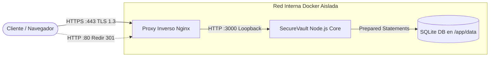

# SecureVault — Manual de Despliegue, Hardening y Verificación

## 1. Arquitectura de Despliegue a Producción



### Controles de Hardening Aplicados:
1. **Contenedor no root (`node` user)**: Cumplimiento de CIS Docker Benchmark para evitar escape de contenedor.
2. **Proxy Inverso Nginx con TLS 1.3 / 1.2 Moderno**: Cifrado en tránsito obligatorio con HSTS preloaded (`max-age=63072000`).
3. **Rate Limiting Perimetral y de Aplicación**: Doble capa de defensa en profundidad contra DoS y fuerza bruta.
4. **Secretos fuera del código**: Variables `ENCRYPTION_MASTER_KEY` y `JWT_SECRET` inyectadas mediante el gestor de orquestación o `.env` restringido.
5. **Base de Datos Protegida**: Archivo SQLite montado en volumen dedicado con permisos Unix `chown node:node` y habilitación de WAL (`Write-Ahead Logging`).

---

## 2. Instrucciones de Despliegue Paso a Paso

### 2.1. Preparación de Secretos
Genere llaves criptográficas de 256 bits antes de iniciar:
```powershell
node -e "const crypto = require('node:crypto'); console.log('ENCRYPTION_MASTER_KEY=' + crypto.randomBytes(32).toString('hex') + '\nJWT_SECRET=' + crypto.randomBytes(32).toString('hex'));"
```
Copie estos valores a su archivo `.env` de producción (nunca subir a Git).

### 2.2. Generación o Colocación de Certificados TLS
- **Para Laboratorio Local**:
  ```powershell
  powershell -ExecutionPolicy Bypass -File .\scripts\generate-certs.ps1
  ```
- **Para Producción Real**:
  Coloque `vault.crt` y `vault.key` emitidos por su Autoridad Certificadora (e.g. Let's Encrypt vía Certbot) en el directorio `./docker/certs/`.

### 2.3. Construcción y Lanzamiento con Docker Compose
```bash
docker compose up -d --build
```

---

## 3. Matriz de Evidencia: Implementado vs. Pendiente en Producción Real

| Requisito / Control | Estado Actual en Código | Verificación Local Ejecutada | Pendiente en Producción Real |
| :--- | :--- | :--- | :--- |
| **RF-01** (Registro y Password Policy) | **Implementado** (`src/routes/auth.routes.js`) | Test unitario e integración pasando (Zod + Bcrypt cost 12). | Monitoreo de telemetría de registros fallidos. |
| **RF-02** (Login/Logout y Cookies) | **Implementado** (`src/services/auth.service.js`) | Test de sesión y Cookie `HttpOnly; SameSite=Strict`. | Validación de bandera `Secure` sobre dominio FQDN con HTTPS activo. |
| **RF-03** (RBAC en Servidor) | **Implementado** (`src/middlewares/auth.middleware.js`) | Intentos con rol inyectado y accesos denegados (403). | Auditoría periódica de cuentas con rol `ADMIN`. |
| **RF-04** (CRUD y Anti-IDOR) | **Implementado** (`src/services/note.service.js`) | Usuario B recibe 404 al intentar leer/modificar nota de Usuario A. | Pruebas de regresión automatizadas en pipeline CI/CD. |
| **RF-05** (AES-256-GCM + Masking) | **Implementado** (`src/crypto/vault.crypto.js`) | IV único de 12 bytes, AuthTag 16 bytes y prueba de manipulación (bit-flip). | Rotación programada de llave maestra (`ENCRYPTION_MASTER_KEY`). |
| **RF-06** (Reset Token SHA-256) | **Implementado** (`src/services/auth.service.js`) | Token 32B CSPRNG, hash SHA-256, expiración y rechazo a re-uso. | Integración con servicio SMTP/SES real para entrega de correos. |
| **RF-07** (Panel Admin y Auditoría) | **Implementado** (`src/services/audit.service.js`) | Bitácora inmutable con sanitización estricta de PII. | Exportación de logs a SIEM (e.g., Wazuh, Elastic, Datadog). |
| **RF-08** (Healthcheck sin fuga) | **Implementado** (`src/routes/health.routes.js`) | Comprobada ausencia de `X-Powered-By` y respuesta minimalista. | Integración con sensor de uptime perimetral (Prometheus/UptimeKuma). |

---

## 4. Comandos de Verificación Técnica

### 4.1. Verificación de Fingerprinting y Cabeceras
```bash
curl -k -I https://localhost/health
```
**Resultado esperado:**
- `HTTP/1.1 200 OK`
- `Strict-Transport-Security: max-age=63072000; includeSubDomains; preload`
- `X-Content-Type-Options: nosniff`
- `X-Frame-Options: DENY`
- **Ausencia total** de `X-Powered-By`.

### 4.2. Verificación de Mitigación de IDOR
```bash
# Con token de Usuario 2 intentando consultar nota de Usuario 1
curl -k -H "Authorization: Bearer <TOKEN_USUARIO_2>" https://localhost/api/v1/notes/<NOTE_ID_USUARIO_1>
```
**Resultado esperado:**
- `HTTP/1.1 404 Not Found`
- Se registra una entrada `ACCESS_DENIED_IDOR` en la tabla `security_audit_logs`.
